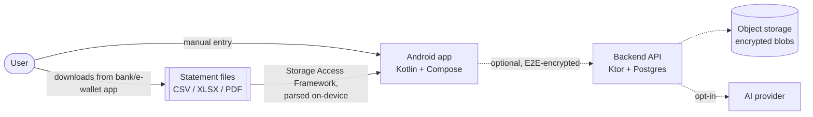
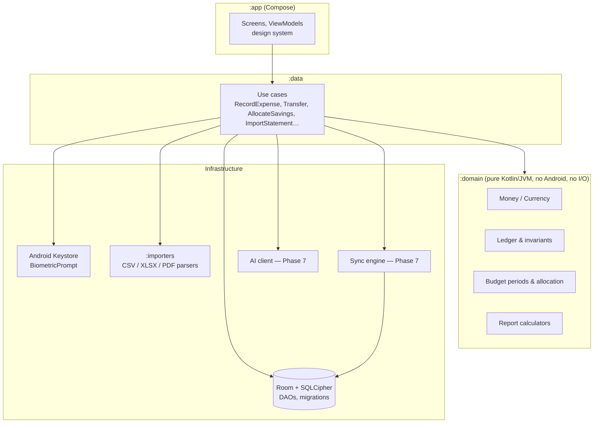

# Architecture Overview (Proposed)

| Status | **Proposed (Phase 1), revision 2.** Android only and no direct integrations (owner decision 2026-11-05). Detailed ERD, API specs, and sequence diagrams are Phase 2 deliverables |
|---|---|
| Date | 2026-11-05 |
| Decisions | [ADR index](adr/README.md) |

## 1. Goals the architecture optimizes for
1. Financial correctness and integrity: a single deterministic ledger and invariants enforced in one place.
2. Local-first: the device is the source of truth, and the network is optional.
3. Low resource use: SQL aggregation in SQLite, paginated reads, no full-history loads.
4. Maintainability: a pure domain core with no UI, DB, or network imports.

## 2. System context



The app is fully functional with **no** backend and **no** network permission use. Every dashed edge is optional and gated by consent.
The app has **no connection to any bank or e-wallet**. Data enters only by manual entry or file import.

## 3. Logical layers (Android)



Rules:
- `:domain` depends on nothing but the Kotlin stdlib and is 100% unit-testable on the JVM (JDK only, no Android SDK).
- Use cases are the **only** writers to the database. Each use case runs inside one SQLite transaction.
- Reports read through SQL aggregates, then pass the results to domain calculators. Totals are never computed from UI-loaded lists.

### Proposed repository layout (single Gradle build)
```
/app                  Android application: Compose UI, ViewModels, DI, Android adapters
/domain               Money, ledger, budgets, savings, debts, reports (pure Kotlin/JVM)
/data                 Room DB, DAOs, migrations, repositories, use cases
/importers            Statement parsers + institution profiles (pure Kotlin where possible)
/server               Ktor backend (Phase 7 only; not created earlier)
/gradle/libs.versions.toml   Version catalog
/docs                 PRD, architecture, ADRs, guides
PROGRESS.md           Feature implementation & traceability matrix
```

## 4. Financial data model (core idea)

Two separate ledgers prevent the most common double-counting bugs:

| Ledger | Answers | Changed by |
|---|---|---|
| **Money ledger** (double-entry) | *Where is the money physically?* | income, expense, transfer, refund, adjustment, debt movements |
| **Allocation ledger** | *What is the money for?* (budget envelopes, savings goals) | budget allocation, savings contribution/withdrawal/reallocation, rollover |

### 4.1 Money ledger: double-entry postings
Every transaction has ≥ 2 **entries** whose amounts sum to zero per currency. User accounts are *real* accounts. Income and expense
categories sit against internal *nominal* accounts (`income:*`, `expense:*`, `equity:opening`, `equity:adjustment`).

| User action | Entries |
|---|---|
| Expense ₱500 from GCash, Food | GCash −500 · expense:Food +500 |
| Transfer ₱2,000 GCash → BPI | GCash −2,000 · BPI +2,000 (no nominal account, so not spending) |
| Card purchase ₱1,200 | Card (liability) −1,200 · expense:Shopping +1,200 |
| Card payment ₱1,200 from BPI | BPI −1,200 · Card +1,200 (transfer) |
| Refund ₱200 linked to Food expense | GCash +200 · expense:Food −200 |
| Loan disbursement ₱10,000 | BPI +10,000 · Loan (liability) −10,000 |
| Loan payment ₱1,100 (₱1,000 principal) | BPI −1,100 · Loan +1,000 · expense:Interest +100 |
| Balance adjustment +₱35 | Cash +35 · equity:adjustment −35 |

Invariants enforced in the domain and checked by property tests:
- Σ entries per transaction per currency = 0.
- Account balance = Σ its posted entries (opening balance is itself a posting).
- Spending = Σ of `expense:*` entries in range, so transfers cannot leak into it.
- Net worth = Σ real asset accounts + Σ real liability accounts (liabilities are negative), so internal transfers net to zero.

### 4.2 Allocation ledger
- `allocation_entry(budget_period_id | goal_id, amount_minor, kind, source, related_txn_id?)`
- "Available to budget" = budget income for the period − Σ allocations to categories and goals.
- A savings contribution with **no** account change is an allocation entry only. A savings contribution that also **moves money**
  to a savings account is a money-ledger transfer **plus** an allocation entry linked to it.
- Net worth reads **only** the money ledger, so goal allocations can never be double-counted (SAV-03).

### 4.3 History & audit
- Transactions are mutable only through use cases that write a `txn_revision` row (before/after JSON, device id, HLC timestamp).
- Deletion is a tombstone (`deleted_at`) plus a revision. Reversal is a new transaction with `reverses_txn_id`.
- Import batches have ids, and rollback tombstones every transaction in the batch.

Phase 2 will produce the full ERD (accounts, nominal accounts, transactions, entries, categories, budgets, periods, allocations,
goals, debts, schedules, bills, assets & valuations, attachments, import batches, external links, revisions, sync state).

## 5. Data flows

### 5.1 Recording a transaction (offline)
```mermaid
sequenceDiagram
  participant UI
  participant UC as UseCase
  participant D as Domain
  participant DB as SQLite
  UI->>UC: RecordExpense(input)
  UC->>UC: validate input
  UC->>D: buildEntries(input) + checkInvariants
  D-->>UC: entries (sum = 0)
  UC->>DB: BEGIN; insert txn, entries, revision, outbox op; COMMIT
  DB-->>UI: committed (query cache invalidated)
```

### 5.2 Statement import (the only non-manual data path)

```mermaid
flowchart LR
  F[File via SAF<br/>CSV / XLSX / PDF] --> D[Detect profile<br/>institution + layout version]
  D -->|unknown| MAP[Manual column mapping]
  D -->|known| P[Parse - pure, :importers]
  MAP --> P
  P --> N[Normalized rows<br/>+ per-row errors]
  N --> DUP[Duplicate matcher<br/>reference no. / fingerprint / fuzzy vs manual entries]
  DUP --> PV[Preview: new / duplicate / rejected<br/>categorize, resolve]
  PV -->|user confirms| TX[One DB transaction:<br/>import_batch + txns + revisions]
  TX --> REC[Optional reconciliation<br/>vs statement closing balance]
```

Files are read through the Storage Access Framework, parsed in memory on-device, and never copied to app storage or uploaded,
unless the user attaches them to a batch as evidence (P2, stored encrypted). Every parsing stage is pure and is tested with
fixture files.

## 6. Synchronization strategy (two separate processes)

| Process | Purpose | Direction |
|---|---|---|
| **Backup** | Disaster recovery | Device → encrypted snapshot file (local via SAF, or cloud) → restore |
| **Device sync** | Same user, several Android devices | Device ⇄ relay ⇄ device, E2E-encrypted operation log |

There is no provider sync, because direct integrations are out of scope. Statement import is a user-initiated local operation and is not part of sync.

### Device sync design (Phase 7, proposed)
- Each device appends **operations** (create/update/tombstone per record) to an outbox, ordered by a **Hybrid Logical Clock**.
- Operations are encrypted client-side with a per-user data key (wrapped per device). The server stores opaque ciphertext plus a
  sequence number and is only a relay with checkpoints.
- Merge is deterministic on every device:
  - **Creates** never conflict, because ids are UUIDv7 generated on the device.
  - **Non-financial fields** (notes, category colour, names): field-level LWW by HLC is acceptable.
  - **Financial fields** (amount, account, date, type, entries): if two devices change the same transaction concurrently
    (neither revision has seen the other), the record goes to a **conflict state**. Both versions are kept, balances use the
    last *agreed* version, and the user resolves the conflict.
  - **Tombstone vs edit**: tombstone wins, but the edit is preserved in the conflict log for user review.
- Balances are never synced. They are always recomputed from entries, so sync cannot corrupt a balance directly.

## 7. Security architecture (summary)
- **At rest:** SQLCipher database. A random 256-bit database key is generated on first run and wrapped by an AES key in the
  **Android Keystore** (StrongBox/TEE-backed where available). Backup files use a key derived with Argon2id from a user passphrase.
  `android:allowBackup="false"` and data-extraction rules stop the OS from copying the database to Google backup in an uncontrolled way.
- **App access:** PIN plus optional BiometricPrompt unlock, auto-lock, and `FLAG_SECURE` (recents/screenshots).
- **In transit:** HTTPS only (Network Security Config, no cleartext). Sync payloads are additionally E2E-encrypted.
  Before Phase 7 the app requires no network access for any feature.
- **Server (Phase 7):** stores no plaintext financial data, enforces per-user isolation, and has rate limits and an audit log. AI secrets are held only there.
- **No institution access:** the app never asks for or stores bank/e-wallet passwords or OTPs (INT-02).
- **Imported files:** read via SAF with no broad storage permission. PDF passwords are held in memory only.
- **Privacy:** no third-party analytics on financial screens, and crash reports have money and PII scrubbed.

## 8. Performance strategy
- Indexes: `entries(account_id, posted_at)`, `transactions(date, deleted_at)`, `entries(nominal_account_id, posted_at)`, FTS4 for text search.
- Paging 3 with Room `PagingSource` (keyset where possible) and `LazyColumn`.
- Optional **period summary cache** table rebuilt incrementally, verified against a full recompute in tests.
- Imports and report recompute run on `Dispatchers.Default`/`IO`, never on the main thread. Large imports are streamed and committed in one transaction per batch.
- Baseline Profiles + R8 for startup and size.

## 9. Key risks addressed by this design
R-02 (double counting) → two ledgers + nominal accounts · R-04 (sync corruption) → no balance sync, conflict state ·
R-05 (rounding) → Long minor units with exact arithmetic + largest remainder · R-03 (bad imports) → preview/confirm + batch rollback.
