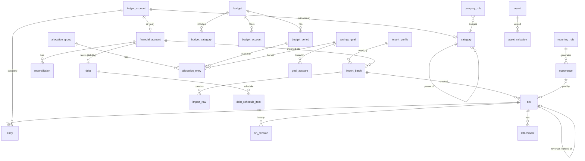

# Database Schema, ERD & Migration Policy

| Status | Phase 2 draft v1 (2026-11-05). Schema version **1** (initial) |
|---|---|
| Engine | SQLite (SQLCipher 4.x) via Room 2.8 (ADR-0002) |
| Semantics | [10-domain-model.md](10-domain-model.md) |

The DDL below is the **reference**. Room entities must produce an equivalent schema, and Phase 3 adds a test that compares the
Room-exported schema JSON with this document's table/column/index list.

## 1. Conventions

| Concern | Rule |
|---|---|
| Table names | singular snake_case; `txn` (not `transaction`, a SQL keyword) |
| Primary keys | `id TEXT` UUIDv7 (36 chars) |
| Money | `*_minor INTEGER NOT NULL` + `currency TEXT` (ISO 4217); never REAL |
| Local dates | `*_date TEXT` ISO `YYYY-MM-DD` (lexicographic order = chronological order) |
| Instants | `*_at INTEGER` epoch milliseconds UTC |
| Enums | `TEXT` with `CHECK (col IN (...))` |
| Booleans | `INTEGER NOT NULL CHECK (col IN (0,1))` |
| Soft delete | `deleted_at INTEGER NULL` on user-deletable financial rows |
| Sync-ready columns (all user-data tables) | `version INTEGER NOT NULL DEFAULT 1`, `updated_at INTEGER NOT NULL`, `updated_by_device TEXT NOT NULL`, `hlc TEXT NOT NULL` (hybrid logical clock, ADR-0007). Present from v1 so Phase 7 needs no data-rewriting migration. |
| Foreign keys | `PRAGMA foreign_keys = ON` at every connection open; `ON DELETE RESTRICT` (default) everywhere except pure child tables noted below |
| Text | User text is stored as entered; `*_norm` columns hold normalized text (NFKD, accents stripped, lower-case, collapsed spaces) for matching |

Abbreviation: below, `SYNC_COLS` = `version, updated_at, updated_by_device, hlc` as defined above.

## 2. ERD



## 3. DDL (schema version 1)

### 3.1 Ledger accounts, accounts, categories
```sql
CREATE TABLE ledger_account (
  id            TEXT PRIMARY KEY,
  class         TEXT NOT NULL CHECK (class IN ('ASSET','LIABILITY','INCOME','EXPENSE','EQUITY')),
  name          TEXT NOT NULL CHECK (length(trim(name)) BETWEEN 1 AND 80),
  currency      TEXT NULL CHECK (currency IS NULL OR length(currency) = 3),  -- required for ASSET/LIABILITY (domain-enforced)
  system_key    TEXT NULL UNIQUE,          -- e.g. 'equity:opening'; NULL for user rows
  archived_at   INTEGER NULL,
  created_at    INTEGER NOT NULL,
  SYNC_COLS
);

CREATE TABLE financial_account (           -- real accounts (ASSET / LIABILITY)
  ledger_account_id   TEXT PRIMARY KEY REFERENCES ledger_account(id),
  type                TEXT NOT NULL CHECK (type IN ('CASH','BANK','EWALLET','SAVINGS','CREDIT_CARD','LOAN','BORROWED','OTHER')),
  institution         TEXT NULL,
  account_number_last4 TEXT NULL CHECK (account_number_last4 IS NULL OR length(account_number_last4) <= 4),
  opening_date        TEXT NOT NULL,
  include_in_net_worth INTEGER NOT NULL DEFAULT 1 CHECK (include_in_net_worth IN (0,1)),
  spendable           INTEGER NOT NULL DEFAULT 1 CHECK (spendable IN (0,1)),  -- counts toward "free money"
  credit_limit_minor  INTEGER NULL,
  default_import_profile_id TEXT NULL REFERENCES import_profile(id),
  last_imported_at    INTEGER NULL,
  reconcile_reminder_days INTEGER NULL CHECK (reconcile_reminder_days IS NULL OR reconcile_reminder_days > 0),
  sort_order          INTEGER NOT NULL DEFAULT 0,
  SYNC_COLS
);

CREATE TABLE category (                    -- nominal INCOME / EXPENSE accounts
  ledger_account_id TEXT PRIMARY KEY REFERENCES ledger_account(id),
  parent_id         TEXT NULL REFERENCES category(ledger_account_id),   -- one level only (domain-enforced)
  icon              TEXT NOT NULL,
  color_argb        INTEGER NOT NULL,
  sort_order        INTEGER NOT NULL DEFAULT 0,
  is_default_seed   INTEGER NOT NULL DEFAULT 0 CHECK (is_default_seed IN (0,1)),
  SYNC_COLS
);
CREATE INDEX ix_category_parent ON category(parent_id, sort_order);
```

### 3.2 Transactions and entries
```sql
CREATE TABLE txn (
  id              TEXT PRIMARY KEY,
  type            TEXT NOT NULL CHECK (type IN ('INCOME','EXPENSE','TRANSFER','SAVINGS_CONTRIBUTION','SAVINGS_WITHDRAWAL',
                    'REFUND','REVERSAL','BALANCE_ADJUSTMENT','DEBT_PAYMENT','DEBT_DISBURSEMENT','OPENING_BALANCE')),
  status          TEXT NOT NULL CHECK (status IN ('PENDING','POSTED')),
  txn_date        TEXT NOT NULL,                 -- local date in user zone
  occurred_at     INTEGER NULL,
  posting_date    TEXT NULL,
  description     TEXT NOT NULL DEFAULT '' CHECK (length(description) <= 200),
  description_norm TEXT NOT NULL DEFAULT '',
  merchant        TEXT NULL CHECK (merchant IS NULL OR length(merchant) <= 120),
  merchant_norm   TEXT NULL,
  notes           TEXT NULL CHECK (notes IS NULL OR length(notes) <= 2000),
  reference_no    TEXT NULL CHECK (reference_no IS NULL OR length(reference_no) <= 64),
  source          TEXT NOT NULL CHECK (source IN ('MANUAL','STATEMENT_IMPORT','SYSTEM')),
  import_batch_id TEXT NULL REFERENCES import_batch(id),
  idempotency_key TEXT NOT NULL UNIQUE,          -- per user action; repeated submit = no-op
  reverses_txn_id TEXT NULL UNIQUE REFERENCES txn(id),   -- UNIQUE: an original can be reversed once
  refund_of_txn_id TEXT NULL REFERENCES txn(id),
  recurring_occurrence_id TEXT NULL UNIQUE REFERENCES occurrence(id),
  fx_rate_display TEXT NULL,                     -- informational only (cross-currency transfers)
  conflict_state  TEXT NOT NULL DEFAULT 'NONE' CHECK (conflict_state IN ('NONE','CONFLICTED')),  -- Phase 7
  created_at      INTEGER NOT NULL,
  deleted_at      INTEGER NULL,
  SYNC_COLS
);
CREATE INDEX ix_txn_date        ON txn(txn_date, id) WHERE deleted_at IS NULL;          -- lists, period reports
CREATE INDEX ix_txn_batch       ON txn(import_batch_id) WHERE import_batch_id IS NOT NULL; -- batch rollback
CREATE INDEX ix_txn_refund_of   ON txn(refund_of_txn_id) WHERE refund_of_txn_id IS NOT NULL;

CREATE TABLE entry (
  id                TEXT PRIMARY KEY,
  txn_id            TEXT NOT NULL REFERENCES txn(id) ON DELETE CASCADE,   -- entries die only with their txn (never in practice: txns are soft-deleted)
  line_no           INTEGER NOT NULL CHECK (line_no >= 0),
  ledger_account_id TEXT NOT NULL REFERENCES ledger_account(id),
  amount_minor      INTEGER NOT NULL CHECK (amount_minor <> 0),
  currency          TEXT NOT NULL CHECK (length(currency) = 3),
  memo              TEXT NULL CHECK (memo IS NULL OR length(memo) <= 200),
  UNIQUE (txn_id, line_no)
);
CREATE INDEX ix_entry_account ON entry(ledger_account_id, txn_id);   -- balances, category spend
-- lookups by txn_id use the implicit index of UNIQUE (txn_id, line_no)
```
Notes:
- **One opening balance per account:** enforced in the domain and by integrity check IC-4 (§5). A partial unique index cannot express it because the account lives on `entry`, not `txn`.
- **Zero-sum (I-1)** cannot be a SQLite CHECK across rows. It is enforced in `:domain` and verified by integrity check IC-1 after every migration and in tests.
- Entries are rewritten as a whole set on edit (delete + insert inside the same DB transaction, with the revision written first).

```sql
CREATE TABLE txn_revision (
  id            TEXT PRIMARY KEY,
  txn_id        TEXT NOT NULL REFERENCES txn(id),
  revision_no   INTEGER NOT NULL CHECK (revision_no >= 1),
  change_kind   TEXT NOT NULL CHECK (change_kind IN ('CREATE','UPDATE','DELETE','RESTORE','IMPORT_ROLLBACK','SYNC_MERGE')),
  before_json   TEXT NULL,                 -- full header + entries snapshot (NULL for CREATE)
  after_json    TEXT NULL,                 -- NULL for DELETE
  reason        TEXT NULL,
  device_id     TEXT NOT NULL,
  created_at    INTEGER NOT NULL,
  UNIQUE (txn_id, revision_no)
);

CREATE TABLE attachment (
  id          TEXT PRIMARY KEY,
  txn_id      TEXT NOT NULL REFERENCES txn(id),
  file_name   TEXT NOT NULL,              -- internal encrypted file name in app-private storage
  mime_type   TEXT NOT NULL CHECK (mime_type IN ('image/jpeg','image/png','image/webp','application/pdf')),
  size_bytes  INTEGER NOT NULL CHECK (size_bytes BETWEEN 1 AND 5242880),
  sha256      TEXT NOT NULL,
  created_at  INTEGER NOT NULL,
  deleted_at  INTEGER NULL,
  SYNC_COLS
);
CREATE INDEX ix_attachment_txn ON attachment(txn_id);

CREATE VIRTUAL TABLE txn_fts USING fts4(content="txn", description, merchant, notes, reference_no);  -- TXN-10 search
```
`txn_fts` is an external-content FTS4 table (Room `@Fts4(contentEntity = Txn::class)`). Room generates the sync triggers.
Phase 4 verifies that search results exclude soft-deleted rows, by joining back to `txn` with `deleted_at IS NULL`.

### 3.3 Reconciliation
```sql
CREATE TABLE reconciliation (
  id                     TEXT PRIMARY KEY,
  account_id             TEXT NOT NULL REFERENCES financial_account(ledger_account_id),
  as_of_date             TEXT NOT NULL,
  statement_balance_minor INTEGER NOT NULL,
  calculated_balance_minor INTEGER NOT NULL,
  difference_minor       INTEGER NOT NULL,     -- statement − calculated, at time of reconciliation
  adjustment_txn_id      TEXT NULL UNIQUE REFERENCES txn(id),
  source                 TEXT NOT NULL CHECK (source IN ('MANUAL','IMPORT')),
  import_batch_id        TEXT NULL REFERENCES import_batch(id),
  created_at             INTEGER NOT NULL,
  SYNC_COLS
);
CREATE INDEX ix_recon_account ON reconciliation(account_id, as_of_date DESC);
```

### 3.4 Budgets and allocation ledger
```sql
CREATE TABLE budget (
  id              TEXT PRIMARY KEY,
  name            TEXT NOT NULL CHECK (length(trim(name)) BETWEEN 1 AND 80),
  currency        TEXT NOT NULL CHECK (length(currency) = 3),
  period_kind     TEXT NOT NULL CHECK (period_kind IN ('WEEKLY','BIWEEKLY','EVERY_N_DAYS','MONTHLY','SEMI_MONTHLY','CUSTOM_ONCE')),
  anchor_date     TEXT NOT NULL,
  anchor_day      INTEGER NULL CHECK (anchor_day IS NULL OR anchor_day BETWEEN 1 AND 31),   -- MONTHLY, SEMI_MONTHLY d1
  anchor_day2     INTEGER NULL CHECK (anchor_day2 IS NULL OR anchor_day2 BETWEEN 1 AND 31), -- SEMI_MONTHLY d2
  every_n_days    INTEGER NULL CHECK (every_n_days IS NULL OR every_n_days BETWEEN 1 AND 366),
  custom_end_date TEXT NULL,                                                               -- CUSTOM_ONCE
  rule_effective_from TEXT NOT NULL,      -- period-rule changes apply from here (domain §5.1)
  income_mode     TEXT NOT NULL CHECK (income_mode IN ('TRACKED','FIXED','MANUAL')),
  fixed_income_minor INTEGER NULL,
  account_filter  INTEGER NOT NULL DEFAULT 0 CHECK (account_filter IN (0,1)),   -- 1 = only budget_account rows
  archived_at     INTEGER NULL,
  created_at      INTEGER NOT NULL,
  SYNC_COLS
);

CREATE TABLE budget_category (
  budget_id         TEXT NOT NULL REFERENCES budget(id),
  category_id       TEXT NOT NULL REFERENCES category(ledger_account_id),
  allocation_mode   TEXT NOT NULL CHECK (allocation_mode IN ('NONE','FIXED','PERCENT')),
  default_amount_minor INTEGER NULL,
  percent_bp        INTEGER NULL CHECK (percent_bp IS NULL OR percent_bp BETWEEN 0 AND 10000),
  rollover_policy   TEXT NOT NULL DEFAULT 'EXPIRE' CHECK (rollover_policy IN ('EXPIRE','CARRY','SWEEP_TO_GOAL','MANUAL')),
  carry_negative    INTEGER NOT NULL DEFAULT 0 CHECK (carry_negative IN (0,1)),
  sweep_goal_id     TEXT NULL REFERENCES savings_goal(id),
  sort_order        INTEGER NOT NULL DEFAULT 0,
  SYNC_COLS,
  PRIMARY KEY (budget_id, category_id)
);

CREATE TABLE budget_account (
  budget_id         TEXT NOT NULL REFERENCES budget(id),
  ledger_account_id TEXT NOT NULL REFERENCES financial_account(ledger_account_id),
  SYNC_COLS,
  PRIMARY KEY (budget_id, ledger_account_id)
);

CREATE TABLE budget_period (
  id          TEXT PRIMARY KEY,
  budget_id   TEXT NOT NULL REFERENCES budget(id),
  start_date  TEXT NOT NULL,
  end_date    TEXT NOT NULL CHECK (end_date >= start_date),
  closed_at   INTEGER NULL,
  SYNC_COLS,
  UNIQUE (budget_id, start_date)
);
CREATE INDEX ix_period_lookup ON budget_period(budget_id, end_date);

CREATE TABLE savings_goal (
  id            TEXT PRIMARY KEY,
  name          TEXT NOT NULL CHECK (length(trim(name)) BETWEEN 1 AND 80),
  currency      TEXT NOT NULL CHECK (length(currency) = 3),
  target_minor  INTEGER NOT NULL CHECK (target_minor > 0),
  target_date   TEXT NULL,
  status        TEXT NOT NULL CHECK (status IN ('ACTIVE','PAUSED','ACHIEVED','ARCHIVED')),
  notes         TEXT NULL,
  icon          TEXT NOT NULL,
  color_argb    INTEGER NOT NULL,
  created_at    INTEGER NOT NULL,
  SYNC_COLS
);

CREATE TABLE goal_account (
  goal_id           TEXT NOT NULL REFERENCES savings_goal(id),
  ledger_account_id TEXT NOT NULL REFERENCES financial_account(ledger_account_id),
  SYNC_COLS,
  PRIMARY KEY (goal_id, ledger_account_id)
);

CREATE TABLE allocation_group (
  id              TEXT PRIMARY KEY,
  kind            TEXT NOT NULL CHECK (kind IN ('FUND','ALLOCATE','REALLOCATE','GOAL_CONTRIBUTE','GOAL_WITHDRAW',
                    'GOAL_DIRECT','GOAL_TRANSFER','ROLLOVER','SWEEP')),
  effective_date  TEXT NOT NULL,
  reason          TEXT NULL CHECK (reason IS NULL OR length(reason) <= 500),
  related_txn_id  TEXT NULL REFERENCES txn(id),
  snapshot_json   TEXT NOT NULL,          -- previous/new allocation per affected bucket (SAV-04)
  confirmed_at    INTEGER NULL,           -- required for GOAL_WITHDRAW / GOAL_TRANSFER (domain-enforced)
  idempotency_key TEXT NOT NULL UNIQUE,   -- rollovers: 'rollover:{period}:{category}'
  created_at      INTEGER NOT NULL,
  deleted_at      INTEGER NULL,
  SYNC_COLS
);

CREATE TABLE allocation_entry (
  id               TEXT PRIMARY KEY,
  group_id         TEXT NOT NULL REFERENCES allocation_group(id) ON DELETE CASCADE,
  bucket           TEXT NOT NULL CHECK (bucket IN ('UNALLOCATED','CATEGORY','GOAL')),
  budget_period_id TEXT NULL REFERENCES budget_period(id),
  category_id      TEXT NULL REFERENCES category(ledger_account_id),
  goal_id          TEXT NULL REFERENCES savings_goal(id),
  amount_minor     INTEGER NOT NULL CHECK (amount_minor <> 0),
  currency         TEXT NOT NULL CHECK (length(currency) = 3),
  CHECK ( (bucket = 'UNALLOCATED' AND budget_period_id IS NOT NULL AND category_id IS NULL AND goal_id IS NULL)
       OR (bucket = 'CATEGORY'    AND budget_period_id IS NOT NULL AND category_id IS NOT NULL AND goal_id IS NULL)
       OR (bucket = 'GOAL'        AND goal_id IS NOT NULL AND category_id IS NULL) )
);
CREATE INDEX ix_alloc_period ON allocation_entry(budget_period_id, bucket, category_id);
CREATE INDEX ix_alloc_goal   ON allocation_entry(goal_id) WHERE goal_id IS NOT NULL;
CREATE INDEX ix_alloc_group  ON allocation_entry(group_id);
```

### 3.5 Debts, assets
```sql
CREATE TABLE debt (
  ledger_account_id  TEXT PRIMARY KEY REFERENCES financial_account(ledger_account_id),   -- LIABILITY account
  kind               TEXT NOT NULL CHECK (kind IN ('PERSONAL_LOAN','CREDIT_CARD','INSTALLMENT','BORROWED','OTHER')),
  counterparty       TEXT NULL,
  original_minor     INTEGER NOT NULL CHECK (original_minor > 0),
  start_date         TEXT NOT NULL,
  interest_rate_bp   INTEGER NULL CHECK (interest_rate_bp IS NULL OR interest_rate_bp >= 0),
  interest_basis     TEXT NULL CHECK (interest_basis IS NULL OR interest_basis IN ('ANNUAL','MONTHLY','ADD_ON')),
  payment_frequency  TEXT NULL CHECK (payment_frequency IS NULL OR payment_frequency IN ('WEEKLY','BIWEEKLY','SEMI_MONTHLY','MONTHLY','QUARTERLY','YEARLY','IRREGULAR')),
  installment_minor  INTEGER NULL CHECK (installment_minor IS NULL OR installment_minor > 0),
  installments_total INTEGER NULL CHECK (installments_total IS NULL OR installments_total > 0),
  due_day            INTEGER NULL CHECK (due_day IS NULL OR due_day BETWEEN 1 AND 31),
  status             TEXT NOT NULL CHECK (status IN ('ACTIVE','PAID_OFF','DEFAULTED','CLOSED')),
  SYNC_COLS
);

CREATE TABLE debt_schedule_item (
  id               TEXT PRIMARY KEY,
  debt_id          TEXT NOT NULL REFERENCES debt(ledger_account_id),
  seq              INTEGER NOT NULL CHECK (seq >= 1),
  due_date         TEXT NOT NULL,
  amount_due_minor INTEGER NOT NULL CHECK (amount_due_minor > 0),
  paid_txn_id      TEXT NULL REFERENCES txn(id),
  SYNC_COLS,
  UNIQUE (debt_id, seq)
);

CREATE TABLE asset (
  id                   TEXT PRIMARY KEY,
  name                 TEXT NOT NULL,
  kind                 TEXT NOT NULL CHECK (kind IN ('INVESTMENT','PROPERTY','VEHICLE','RECEIVABLE','OTHER')),
  currency             TEXT NOT NULL CHECK (length(currency) = 3),
  include_in_net_worth INTEGER NOT NULL DEFAULT 1 CHECK (include_in_net_worth IN (0,1)),
  notes                TEXT NULL,
  archived_at          INTEGER NULL,
  created_at           INTEGER NOT NULL,
  SYNC_COLS
);

CREATE TABLE asset_valuation (
  id          TEXT PRIMARY KEY,
  asset_id    TEXT NOT NULL REFERENCES asset(id),
  as_of_date  TEXT NOT NULL,
  value_minor INTEGER NOT NULL CHECK (value_minor >= 0),
  note        TEXT NULL,
  deleted_at  INTEGER NULL,
  SYNC_COLS
);
CREATE INDEX ix_valuation ON asset_valuation(asset_id, as_of_date DESC);
```

### 3.6 Recurring rules and occurrences
```sql
CREATE TABLE recurring_rule (
  id               TEXT PRIMARY KEY,
  kind             TEXT NOT NULL CHECK (kind IN ('BILL','SUBSCRIPTION','RECURRING_TXN','EXPECTED_INCOME')),
  name             TEXT NOT NULL,
  amount_minor     INTEGER NOT NULL CHECK (amount_minor > 0),
  currency         TEXT NOT NULL CHECK (length(currency) = 3),
  amount_is_estimate INTEGER NOT NULL DEFAULT 0 CHECK (amount_is_estimate IN (0,1)),
  frequency        TEXT NOT NULL CHECK (frequency IN ('WEEKLY','BIWEEKLY','EVERY_N_DAYS','MONTHLY','SEMI_MONTHLY','QUARTERLY','YEARLY')),
  interval_n       INTEGER NULL,
  day1             INTEGER NULL,
  day2             INTEGER NULL,
  month_of_year    INTEGER NULL CHECK (month_of_year IS NULL OR month_of_year BETWEEN 1 AND 12),
  anchor_date      TEXT NOT NULL,
  end_date         TEXT NULL,
  account_id       TEXT NULL REFERENCES financial_account(ledger_account_id),
  category_id      TEXT NULL REFERENCES category(ledger_account_id),
  template_json    TEXT NULL,               -- RECURRING_TXN: full txn template
  auto_post        INTEGER NOT NULL DEFAULT 0 CHECK (auto_post IN (0,1)),
  reminder_days_before INTEGER NULL CHECK (reminder_days_before IS NULL OR reminder_days_before BETWEEN 0 AND 30),
  status           TEXT NOT NULL CHECK (status IN ('ACTIVE','PAUSED','ENDED')),
  created_at       INTEGER NOT NULL,
  SYNC_COLS
);

CREATE TABLE occurrence (
  id            TEXT PRIMARY KEY,
  rule_id       TEXT NOT NULL REFERENCES recurring_rule(id),
  due_date      TEXT NOT NULL,
  amount_minor  INTEGER NOT NULL,
  status        TEXT NOT NULL CHECK (status IN ('UPCOMING','PAID','SKIPPED')),   -- DUE/OVERDUE are derived from dates
  paid_txn_id   TEXT NULL REFERENCES txn(id),
  SYNC_COLS,
  UNIQUE (rule_id, due_date),
  CHECK ((status = 'PAID') = (paid_txn_id IS NOT NULL))
);
CREATE INDEX ix_occurrence_due ON occurrence(due_date, status);
```

### 3.7 Import
```sql
CREATE TABLE import_profile (
  id              TEXT PRIMARY KEY,
  name            TEXT NOT NULL,
  institution     TEXT NULL,
  format          TEXT NOT NULL CHECK (format IN ('CSV','XLSX','PDF')),
  layout_version  INTEGER NOT NULL DEFAULT 1,
  builtin         INTEGER NOT NULL CHECK (builtin IN (0,1)),     -- shipped & verified vs user-defined mapping
  detection_json  TEXT NULL,
  mapping_json    TEXT NOT NULL,
  created_at      INTEGER NOT NULL,
  SYNC_COLS
);

CREATE TABLE import_batch (
  id                TEXT PRIMARY KEY,
  account_id        TEXT NOT NULL REFERENCES financial_account(ledger_account_id),
  profile_id        TEXT NULL REFERENCES import_profile(id),
  file_name         TEXT NOT NULL,
  file_sha256       TEXT NOT NULL,
  file_size_bytes   INTEGER NOT NULL,
  format            TEXT NOT NULL CHECK (format IN ('CSV','XLSX','PDF')),
  status            TEXT NOT NULL CHECK (status IN ('COMMITTED','ROLLED_BACK')),   -- previews are never persisted
  statement_start_date TEXT NULL,
  statement_end_date   TEXT NULL,
  statement_closing_minor INTEGER NULL,
  rows_total        INTEGER NOT NULL,
  rows_imported     INTEGER NOT NULL,
  rows_duplicate    INTEGER NOT NULL,
  rows_rejected     INTEGER NOT NULL,
  rows_skipped_by_user INTEGER NOT NULL,
  committed_at      INTEGER NOT NULL,
  rolled_back_at    INTEGER NULL,
  SYNC_COLS,
  CHECK (rows_total = rows_imported + rows_duplicate + rows_rejected + rows_skipped_by_user)
);
CREATE INDEX ix_batch_account ON import_batch(account_id, committed_at DESC);

CREATE TABLE import_row (
  batch_id      TEXT NOT NULL REFERENCES import_batch(id) ON DELETE CASCADE,
  row_no        INTEGER NOT NULL,
  outcome       TEXT NOT NULL CHECK (outcome IN ('IMPORTED','DUPLICATE','REJECTED','SKIPPED')),
  txn_id        TEXT NULL REFERENCES txn(id),
  matched_txn_id TEXT NULL REFERENCES txn(id),   -- for DUPLICATE
  fingerprint   TEXT NULL,
  error_code    TEXT NULL,
  PRIMARY KEY (batch_id, row_no)
);

CREATE TABLE txn_fingerprint (                -- idempotent re-import (13-import-pipeline.md §5)
  account_id   TEXT NOT NULL REFERENCES financial_account(ledger_account_id),
  fingerprint  TEXT NOT NULL,
  txn_id       TEXT NOT NULL REFERENCES txn(id),
  PRIMARY KEY (account_id, fingerprint)
);
CREATE INDEX ix_fp_txn ON txn_fingerprint(txn_id);
```

### 3.8 Rules, audit, metadata
```sql
CREATE TABLE category_rule (
  id            TEXT PRIMARY KEY,
  priority      INTEGER NOT NULL,
  match_field   TEXT NOT NULL CHECK (match_field IN ('DESCRIPTION','MERCHANT','ANY_TEXT')),
  match_op      TEXT NOT NULL CHECK (match_op IN ('EQUALS','CONTAINS','STARTS_WITH')),
  pattern_norm  TEXT NOT NULL CHECK (length(pattern_norm) BETWEEN 1 AND 120),
  min_minor     INTEGER NULL,
  max_minor     INTEGER NULL,
  account_id    TEXT NULL REFERENCES financial_account(ledger_account_id),
  category_id   TEXT NOT NULL REFERENCES category(ledger_account_id),
  mode          TEXT NOT NULL CHECK (mode IN ('SUGGEST','AUTO')),
  enabled       INTEGER NOT NULL DEFAULT 1 CHECK (enabled IN (0,1)),
  SYNC_COLS
);
CREATE INDEX ix_rule_priority ON category_rule(enabled, priority);

CREATE TABLE audit_event (                     -- security + non-txn financial events (SEC-04); append-only
  id          TEXT PRIMARY KEY,
  kind        TEXT NOT NULL,                   -- e.g. APP_UNLOCK_FAILED, BACKUP_CREATED, RESTORE, IMPORT_COMMITTED, IMPORT_ROLLED_BACK, ACCOUNT_ARCHIVED
  entity_type TEXT NULL,
  entity_id   TEXT NULL,
  detail_json TEXT NULL,                       -- never contains PINs, passphrases, or file contents
  device_id   TEXT NOT NULL,
  created_at  INTEGER NOT NULL
);
CREATE INDEX ix_audit_time ON audit_event(created_at);

CREATE TABLE app_meta (                        -- key/value: device_id, hlc_last, schema notes
  key   TEXT PRIMARY KEY,
  value TEXT NOT NULL
);
```
UI preferences (theme, last tab) live in Jetpack DataStore, not in this database.

## 4. Query-to-index map (performance, NFR-03/04)

| Query | Index used |
|---|---|
| Transaction list by date, paged (keyset `txn_date DESC, id DESC`) | `ix_txn_date` |
| Account balance / account transaction list | `ix_entry_account` → join `txn` by PK |
| Category spend in date range | `ix_txn_date` range → `entry` by `txn_id` (PK/unique) filtered by account set |
| Budget period lookup | `ix_period_lookup` |
| Available-to-budget, category allocated | `ix_alloc_period` |
| Goal allocated | `ix_alloc_goal` |
| Import duplicate check | `txn_fingerprint` PK; fuzzy: `ix_entry_account` + date window |
| Batch rollback | `ix_txn_batch` |
| Upcoming bills | `ix_occurrence_due` |
| Text search | `txn_fts` |

Phase 3/4 benchmark gate: 100k transactions (≈ 230k entries) on the reference device, with every query in this table checked against NFR-03/04.
If category-spend-by-range misses the target, add the planned derived table `entry_day_summary(ledger_account_id, txn_date, currency, sum_minor)`,
maintained in the same write transaction. It is verified against recompute by IC-6 and is not added before that measurement.

## 5. Integrity checks (run in tests, after every migration, after restore, and on demand from a debug screen)

| ID | Check (must return zero rows) |
|---|---|
| IC-1 | `SELECT txn_id, currency FROM entry GROUP BY txn_id, currency HAVING SUM(amount_minor) <> 0` |
| IC-2 | Entries on real accounts whose currency ≠ account currency |
| IC-3 | Transactions with < 2 entries |
| IC-4 | Accounts with more than one non-deleted OPENING_BALANCE |
| IC-5 | Allocation groups (kinds other than FUND, GOAL_DIRECT) whose entries do not sum to zero per currency |
| IC-6 | Any derived/cached summary ≠ recompute |
| IC-7 | Refund totals exceeding the original expense amount |
| IC-8 | `PRAGMA foreign_key_check` and `PRAGMA integrity_check` |

## 6. Migration policy (LOC-04)
1. Schema version is an integer. Room `exportSchema = true`, and schema JSON is committed under `data/schemas/`.
2. Migrations are **forward-only, hand-written `Migration(n, n+1)`** objects. `fallbackToDestructiveMigration` is **forbidden** (lint check).
3. Before any migration runs, the app writes an encrypted pre-migration backup (14-backup-format.md) to app-private storage, keeping the last 2.
4. Each migration runs in one transaction. After it runs, IC-1..IC-8 must pass, or the app keeps the old database file and reports the error. It never leaves a half-migrated DB.
5. Every migration has a `MigrationTestHelper` test from a fixture database at version n with realistic data.
6. Destructive column changes use the SQLite 12-step table rebuild, and the change is documented in the migration's KDoc.
